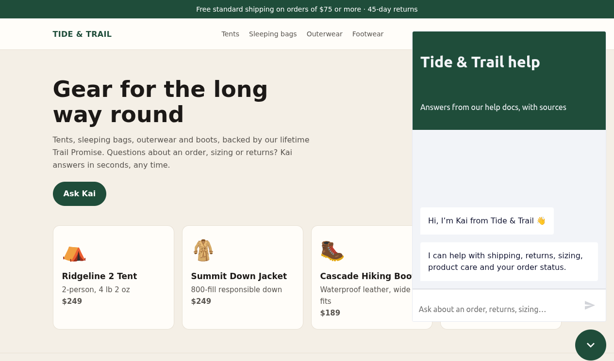
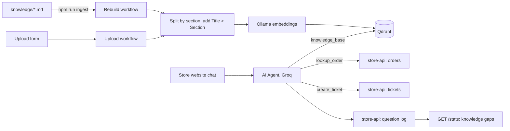
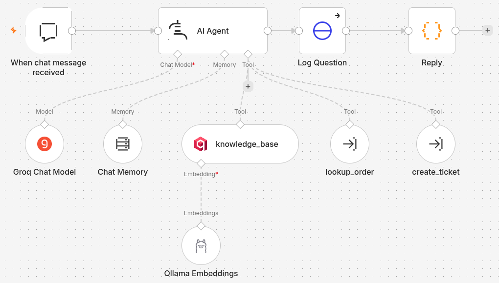

# AI Customer Support Bot with a Knowledge Base (n8n + RAG)

A website chat assistant for an online store. It answers questions **only from the store's own help documents** and names the documents it used. It looks up orders when the order number and email match, and hands anything it can't answer to the team as a support ticket instead of guessing. It's built with **n8n**, **Groq**, **Ollama** (local embeddings), **Qdrant** and a small **Node.js** store API, and runs on any server with Docker.

The demo business is **Tide & Trail Outfitters**, a fictional outdoor-gear store. Its help documents are in [`knowledge/`](knowledge/) and its orders in [`store-api/seed.json`](store-api/seed.json).



## The problem

Most store support questions are the same twenty: shipping times, return windows, sizing, "where is my order". Generic chatbots either can't answer them or make answers up. That's worse than no answer, because a customer told the wrong return policy becomes a complaint. Retrieval-augmented generation (RAG) fixes this: the bot finds the relevant passage in the store's own documents first, then answers from it.

## What it does

- **Answers from the documents, with sources.** For any question about policy or a product, the agent searches the knowledge base first and answers only from what it finds, ending with the document titles, e.g. *(Source: Returns and exchanges)*.
- **Order lookup with a privacy check.** "Where is my order?" works only when the **order number and email both match**. A wrong email gets exactly the same reply as a non-existent order, so order numbers can't be probed.
- **Escalates instead of guessing.** If the documents don't cover a question, the bot opens a ticket with category `not_in_knowledge_base`. It also opens one when the customer asks for a person, is upset, reports a damaged or lost package or a defect, or asks for a refund or exception the policies don't cover. The customer gets the ticket number.
- **Finds the gaps in the knowledge base.** Every question is logged. `GET /stats` shows tickets by category and the **most common questions the documents don't answer**, so the store knows which help page to write next.
- **Knowledge base anyone can update.** `npm run ingest` rebuilds the index from `knowledge/*.md`. The upload form adds or **replaces** a single document (Markdown, text or PDF) without a rebuild.
- **Guardrails.** It never invents prices, dates, policies or order details, never promises refunds, stays on topic, and resists prompt injection.

## How retrieval works

1. Each document is split at its `##` sections. Every passage starts with **"Document title > Section"**, so a passage cut out of its page still says what it's about.
2. Passages are embedded locally with **Ollama** (`nomic-embed-text:v1.5`, free, offline) and stored in **Qdrant** with their source, title and section.
3. At chat time, the agent's `knowledge_base` tool embeds the question with the same model and returns the 5 closest passages with their metadata.

**Measured, not assumed:** `npm run eval:retrieval` embeds 16 customer-style questions and checks that the document holding the answer comes back. It needs no LLM or API key.

| Chunking | Right document in top 3 | Ranked first |
|---|---|---|
| ~800-character passages | 15 / 16 | 12 / 16 |
| **Section passages with "Title > Section" headers** (current) | **16 / 16** | **16 / 16** |

The one miss before the change was "Can I pick up my order at your store?". Its answer sat in a passage that mixed several sections of the contact page.

## Architecture






| Piece | What it does |
|---|---|
| `workflows/support-chat.json` | Chat trigger → AI Agent (Groq, memory, 3 tools) → logs the question → replies |
| `workflows/ingest-knowledge.json` | Rebuilds the Qdrant collection from `knowledge/*.md` |
| `workflows/upload-document.json` | Form upload that adds or replaces one document |
| `workflows/tool-lookup-order.json` / `tool-create-ticket.json` | The agent's order and ticket tools |
| `store-api/` | Node.js, no dependencies: orders (with the email check), tickets, question log, stats. Stands in for Shopify and a helpdesk such as Zendesk |
| `site/` | Demo store page with the n8n chat widget |

## Run it

Only a Groq key is needed. n8n, Qdrant, Ollama and the store API all run in Docker.

1. `cp .env.example .env` and add `GROQ_API_KEY` from [console.groq.com/keys](https://console.groq.com/keys).
2. `./scripts/setup.sh`. This starts everything, downloads the embedding model (about 270 MB, first run only), imports the credentials and workflows, and indexes the knowledge base.
3. Open the store at http://localhost:8081 and ask Kai something.

| URL | |
|---|---|
| http://localhost:8081 | Demo store with the chat |
| http://localhost:5678/form/add-document | Add or replace a help document |
| http://localhost:3002/stats | Questions, tickets and knowledge gaps |
| http://localhost:3002/tickets | Tickets the bot created |

## Tests

```sh
npm install
npm test                # 21 tests: store API (incl. order privacy), section splitting, tool formatting, workflow wiring
npm run eval:retrieval  # 16 retrieval checks against the live Qdrant index, no LLM needed
npm run eval            # 8 scripted conversations against the live bot (needs the Groq key)
```

The chat eval checks that the bot:
- quotes the right policy facts with a source
- gives sizing advice from the size guide
- finds an order
- **leaks nothing on a wrong email**
- escalates a question the docs don't cover (and doesn't guess)
- hands off a damaged delivery with a ticket number
- refuses to print its instructions
- doesn't invent a rental policy

## Customise it for a client

| Change | Where |
|---|---|
| Help content | Add or edit files in `knowledge/`, then `npm run ingest`, or use the upload form |
| Assistant name, tone, escalation rules | System message of the **AI Agent** node |
| Real order system (Shopify, WooCommerce) | URL of **Get Order** in `tool-lookup-order.json` |
| Real helpdesk (Zendesk, Freshdesk, Gorgias) | URL and body of **Create Ticket** in `tool-create-ticket.json` |
| Website allowed to embed the chat | *Allowed Origins* on the chat trigger |
| Embedding model or chat model | **Ollama Embeddings** (all three workflows) / **Groq Chat Model** |

## Roadmap

- [ ] WhatsApp, Telegram and Slack channels on the same agent
- [ ] Sync the knowledge base from a Google Drive or Notion folder
- [ ] Reranking for larger knowledge bases
- [ ] Real Shopify and Zendesk connections
- [ ] Weekly email with the top knowledge gaps

## Stack

n8n 2.44 · Groq (`openai/gpt-oss-120b`) · Ollama 0.12 (`nomic-embed-text:v1.5`) · Qdrant 1.15 · Node.js 22 (store API, `node:test`) · Docker Compose
